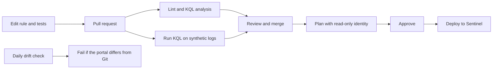

# Sentinel Detection as Code

A small, working template for managing Microsoft Sentinel analytics rules in Git. Each rule is a YAML file with its own test cases. Pull requests validate the rule and run its KQL against synthetic logs. Merging to `main` deploys it to your workspace using GitHub OIDC, so no Azure secrets are stored.



## Included detections

Five starter rules cover Azure activity and Entra ID. See the generated [catalog](docs/catalog.md), or load the [ATT&CK Navigator layer](docs/attack-layer.json). Treat these as starting points and tune their thresholds to your environment.

## Quick start, without Azure

You need Python 3.10+, Node.js 22, and Docker for the emulator.

```bash
python -m venv .venv && source .venv/bin/activate
make setup      # Install the tooling
make check      # Lint rules, analyze KQL and test the tooling

make kusto-up   # Start the Kusto emulator, which can take a minute or two
make test-kql   # Run each rule's real KQL against its test cases
make kusto-down
```

## Connect it to Sentinel

You need a workspace with Microsoft Sentinel enabled, rights to create app registrations and role assignments, and the Azure and GitHub CLIs.

1. Push this repo to GitHub.
2. Create the identities. They have no secrets, and their roles are limited to the workspace.

   ```bash
   ./scripts/bootstrap-azure.sh <subscription-id> <resource-group> <workspace-name> <owner/repo>
   ```

3. Run the `gh` commands the script prints. They set the repo variables and create two environments, `sentinel-read` and `sentinel-production`.
4. In GitHub, go to **Settings > Environments** and limit both environments to the `main` branch. Otherwise, a workflow on another branch could request the same Azure identity. On **sentinel-production**, also add required reviewers. On private repos, these protections depend on your GitHub plan.
5. Protect `main`: require pull requests and the `validate` and `detection-tests` checks.
6. Connect the data sources the rules need. Each rule lists them under `requiredDataConnectors`. Sentinel rejects a rule if a table it queries doesn't exist in the workspace yet. The other rules still deploy, and the run fails with the reason.
7. Run the **Deploy** workflow, or merge a rule change.

Until `SENTINEL_WORKSPACE` is set, the Azure jobs are skipped, so CI stays green on a fresh repo.

## Add a detection

1. Create `detections/<source>/<rule-name>.yaml`. It uses [Microsoft's analytics rule format](https://learn.microsoft.com/azure/sentinel/isv/sentinel-analytic-rules-creation), and `id` must be a new GUID that never changes.
2. Create `<rule-name>.tests.yaml` next to it, with at least one `fire` case and one `silent` case:

   ```yaml
   cases:
     - name: Twelve deletions fire
       expect: fire              # Or silent
       expect_rows: 1            # Optional
       expect_first_row:         # Optional: check extracted values
         DeletedResources: 12
       tables:
         AzureActivity:
           - repeat: 12          # Optional: {i} becomes the row number
             minutes_ago: 10     # Sets TimeGenerated
             OperationNameValue: Microsoft.Compute/virtualMachines/delete
             ActivityStatusValue: Success
             Caller: mallory@contoso.com
             _ResourceId: /subscriptions/0/resourceGroups/prod/providers/Microsoft.Compute/virtualMachines/vm{i}
   ```

3. Using a new table? Add its columns to `schemas/tables.yaml`.
4. Using `_GetWatchlist`? Add `watchlists: {alias: [value1, value2]}` to the test case. The test stub provides only the `SearchKey` column.
5. Run `sdac catalog`, then `make check`, then open a pull request.

To change a rule, edit it and bump `version`. To turn one off, set `enabled: false`. To remove one, delete its files and run the **Deploy** workflow with **prune** on. Pruning only deletes rules this repo deployed, which it recognizes by a marker in the description. Portal and content hub rules are never touched.

## What each gate catches

| Gate | Catches | Needs |
| --- | --- | --- |
| `sdac validate` | Invalid fields, durations and limits, KQL syntax errors, unknown tables or columns, mapped columns the query doesn't return, missing tests | Node.js |
| `sdac validate --base <ref>` | Changed rule IDs and changes without a version bump | Git history |
| `sdac test` | Logic errors: a rule that misses the attack, fires on benign data, or extracts the wrong values | Kusto emulator |
| `sdac plan` | Exactly what would change, including portal edits (drift) | Azure read access |

Passing tests prove a rule's logic against your fixtures. They can't tell you how noisy it will be or whether the fixtures match your real logs. Before merging, run the query in Log Analytics against real data.

## Commands

```text
sdac validate [--base REF] [--no-kql]    Lint rules and analyze KQL offline
sdac test [--only TEXT] [--wait SECONDS] Run test cases against a Kusto emulator
sdac plan [--detailed-exitcode]          Show changes. Exit code 2 means changes exist
sdac deploy [--prune]                    Apply changes to Sentinel
sdac catalog [--check]                   Generate the catalog and ATT&CK layer
```

`plan` and `deploy` read `AZURE_SUBSCRIPTION_ID`, `SENTINEL_RESOURCE_GROUP` and `SENTINEL_WORKSPACE`, and use your `az login` session. Set `SDAC_API_VERSION` to change the API version, or `SDAC_ARM_ENDPOINT` for a sovereign cloud.

## Good to know

- **Scheduled rules only.** NRT rules, automation rules and playbooks aren't deployed by this tooling.
- **Sub-techniques stay in Git.** The stable API's `techniques` field gets the parent technique (`T1098`), while the catalog and ATT&CK layer keep the full ID (`T1098.003`).
- **Portal edits get reverted.** The next deployment restores what's in Git, unless the edit was made after the plan ran, in which case the etag check fails that rule's update.
- **Scheduled workflows can pause.** GitHub disables scheduled runs in public repos after 60 days without activity.

## Layout

```text
detections/   Rules and their test cases
schemas/      Rule format and table schemas
sdac/         CLI: validate, test, plan, deploy, catalog
kql-check/    Offline KQL analyzer, using Microsoft's Kusto language library
tests/        Tests for the tooling, using fake Azure and Kusto servers
scripts/      Azure identity setup
docs/         Generated catalog and ATT&CK layer
.github/      CI, deployment and drift workflows
```

## License

[MIT](LICENSE)
